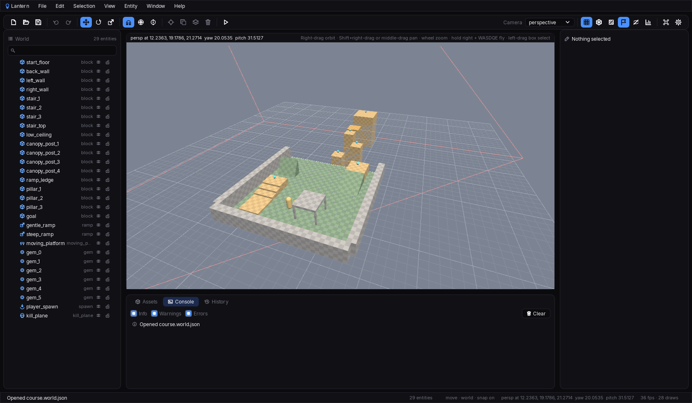

# Lantern world editor

The world editor opens a world file, shows it in a 3D viewport and lets you select, move, rotate,
scale, add, duplicate, mirror, align, group, hide, lock, re-parent and delete entities, edit their
fields, undo and redo, play the level in the real game and save. It is isolated from the game: it
never links the game, and the game never links it. The two share only the world file format
(`crates/world-format`) and the game's assets.



## Architecture

```text
apps/world-editor (C++26, CMake)                      crates/ (Rust)
┌──────────────────────────────────────────┐          ┌──────────────────────────────────┐
│ src/ui/*.chaos *.cosmos *.nyx            │          │ lantern-editor-backend           │
│   menus, toolbar, outliner, inspector,   │          │   EditorBackend                  │
│   assets, console, history, settings,    │          │   ├── EditorSession ─────────────┼──► lantern-editor-core
│   palette, dialogs, status bar           │          │   ├── GpuRenderer (off-screen) ──┼──► lantern-sdl-gpu
│   Editor services via @provide/@context  │          │   ├── preview, thumbnails, play  │
│        │ calls editor*() host functions  │  C API   │   └── ffi.rs                     │
│ src/EditorHost.cpp ──────────────────────┼─────────►│   include/lantern_editor.h       │
│ src/native/EditorViewportRenderers.cpp ──┼─────────►│                                  │
│   IViewportRenderer per view: level,     │          └──────────────────────────────────┘
│   preview, thumbnail:<template>          │                       │
│                                          │                       ▼
│ Penumbra · Chaos · Cosmos · nyx-proto    │          lantern-world-format ◄── the game host
└──────────────────────────────────────────┘          (WorldFile, build_pieces)   loads the same file
```

- **`lantern-world-format`** is the seam. It defines the JSON world file (`WorldFile`,
  `WorldEntity`, shapes, materials, tints, colliders and free-form properties) and turns a world
  into meshes and collision triangles (`build_pieces`). The game host and the editor both use it.
- **`lantern-editor-core`** is all the editor's logic, in plain Rust with no window or GPU:
  the document and its labelled undo history, selection, the orbit camera with presets,
  bookmarks and orthographic views, picking and box selection, the move, rotate and scale gizmos
  with snapping, world or local space and primary or centre pivots, the inspector's fields, the
  outline, hiding and locking, the editing operations, preferences and the input state machine.
  It is unit tested.
- **The editor backend** owns one `EditorSession` and an off-screen `GpuRenderer`. It
  draws the viewport, the template thumbnails and the turntable preview into memory, launches
  the game for play-in-editor, and exposes everything through a C API
  (`engine/editor-backend/include/lantern_editor.h`). It is written in Nox
  (`engine/src/editorbackend/` and `engine/editor-backend/`, `docs/decisions.md` D-051) and built
  as a static library linked against the system SDL3, the same SDL Penumbra uses. The Rust
  backend (`crates/editor-backend`) implements the same header and is still there to compare
  with: configure with `-DLANTERN_EDITOR_BACKEND=rust` to link it instead.
- **`apps/world-editor`** is the front end, built the same way as Pharos. `main.cpp` opens the
  backend, loads the UI through `ChaosApplicationHost`, registers the viewport renderers and
  runs. `EditorHost.cpp` registers one Nyx host function per C API call (`editorRevision()`,
  `editorSelect(id, additive)` and so on). The panels are Chaos components styled by Cosmos,
  one component per file. `EditorApplication.nyx` only sets up the application. `App.chaos`
  provides an `Editor` whose services hold the shared UI state as signals: `EditorDocument` polls
  `editorRevision()` each frame and refreshes what it mirrors when the revision changes, and
  `EditorCommands`, `EditorOverlays`, `EditorKeyboard`, `EditorSelection` and `EditorLayout` do the
  rest. Components read it with `@context` and keep their own state (`docs/decisions.md` D-031 to D-040,
  D-055).

### What the editor knows about the game

Nothing by name. The game ships `assets/editor/palette.json`, which lists:

- **templates** for the asset browser and the Entity menu (a label plus a partial entity: kind,
  shape, material, tint, collider, properties, and how far to lift it above the surface it
  lands on);
- **markers**: how to draw an entity that has no shape (a gem mesh, a capsule, a plane outline),
  by kind;
- **materials**: the names the inspector offers, each a texture in `assets/textures/`.

Without a palette the editor still works, with generic blocks, ramps and markers.

## Build and run

You need everything the game needs, plus the C++ UI stack:

- GCC 14 or Clang 19, CMake 3.30 or later and Ninja.
- SDL3, SDL3_ttf and SDL3_image installed where CMake and pkg-config find them. On Arch:
  `pacman -S sdl3 sdl3_ttf sdl3_image`. On macOS: `brew install sdl3 sdl3_ttf sdl3_image`.
- Network access on the first configure, when CMake fetches Penumbra, Chaos, Cosmos,
  penumbra-ui-backend and Cimmerian (and Chaos fetches nyx-proto).

```sh
cmake -S apps/world-editor -B apps/world-editor/build -G Ninja -DCMAKE_BUILD_TYPE=Release
cmake --build apps/world-editor/build
apps/world-editor/build/lantern-world-editor                      # opens assets/worlds/course.world.json
apps/world-editor/build/lantern-world-editor path/to/other.world.json
```

Every build also runs `lantern-world-editor --host-surface src/ui/editor-host-surface.json`, which
writes the names the editor's host registers (its `editor*` functions, `appInstance`, Penumbra's
`Application` members, `Component` and `@signal`) for `nyx check` and nyx-lsp, through
`src/ui/.nyx.json`. Commit it when it changes.

CMake runs `nox build` over `engine/editor-backend` itself when a Nox source changes, so `nox` has
to be on `PATH` and `engine/generated/` has to exist: run `engine/tools/bind-sdl.sh` and
`engine/tools/install-dependencies.sh` first (`engine/README.md`). The backend finds its compiled
shaders in `engine/shaders/compiled/` (run `engine/tools/build-shaders.sh`), or in
`LANTERN_SHADER_DIRECTORY`. With `-DLANTERN_EDITOR_BACKEND=rust`, CMake runs
`cargo build -p lantern-editor-backend` instead; if SDL3 is somewhere pkg-config doesn't look, set
`PKG_CONFIG_PATH` (for example `/usr/local/lib/pkgconfig`).

The stack is fetched from `proto` (Penumbra, Chaos, Cosmos) and `main` (penumbra-ui-backend,
Cimmerian). To build against other branches or local checkouts:

```sh
-DLANTERN_STACK_BRANCH=claude/my-branch          # every dependency from one branch
-DLANTERN_PENUMBRA_BRANCH=claude/my-branch       # one dependency
-DFETCHCONTENT_SOURCE_DIR_PENUMBRA=../penumbra   # a local checkout (CMake's own switch)
```

The backend is tested without the app. Its Nox parts are in the engine's test suite
(`engine/tests/editor/` and `engine/tests/editorbackend/`, run by `engine/tools/run-tests.sh`),
and `engine/editor-backend` builds on its own with a C test of the whole C API:

```sh
cmake -S engine/editor-backend -B engine/editor-backend/build -G Ninja
cmake --build engine/editor-backend/build
ctest --test-dir engine/editor-backend/build --output-on-failure   # needs a GPU or lavapipe for the render test
```

`LANTERN_REQUIRE_GPU=1` turns a skipped render into a failure, and `LANTERN_EDITOR_CAPTURE=out.ppm`
saves the rendered viewport.

## The panels

- **Menu bar**: File (new, open, recent files, save, save as, play, settings, quit), Edit
  (undo, redo, duplicate, duplicate along an axis, mirror, delete, snap, space, pivot),
  Selection (all, invert, children, deselect, hide, unhide all, lock, unlock, unparent,
  group, align and distribute along an axis), View (frame, camera presets, bookmarks,
  grid, wireframe, colliders, markers, level bounds, hidden entities, stats, orthographic,
  align camera and selection), Entity (one entry per template, snap to ground, revert to and
  apply to template), Window (which bottom panel is shown, the command palette) and Help
  (controls, keyboard shortcuts, about).
- **Toolbar**: file buttons, undo and redo, the move, rotate and scale tools, snap, world or
  local space, pivot, frame, duplicate, group, delete, play and stop, the camera preset
  dropdown, the view toggles, the command palette and settings. Every button has a tooltip.
- **Outliner**: the entity tree with a search box, kind icons, expand and collapse, eye and
  lock toggles per row, click and Shift-click selection, and drag-and-drop: drop on a row to
  parent under it, on the line between two rows to move just before the lower one (taking its
  parent), and on the empty tail to move to the end of the root. Right-click opens a context menu.
- **Viewport**: the level, with the camera's description and the controls hint in its header.
  Drop a template from the asset browser into it to add an entity under the cursor.
- **Inspector**: the selection's fields in collapsible groups. Vectors edit X, Y and Z side by
  side, choices are dropdowns, flags are checkboxes, tints show a swatch. With several entities
  selected, a field shows "mixed" where they differ and an edit applies to all of them. The
  properties group adds, renames and removes free-form properties.
- **Assets**: a card per template with a rendered thumbnail; selecting one shows it spinning in
  the preview, "Add to world" adds it at the camera's focus, and dragging it into the viewport
  adds it where it lands.
- **Console**: the status line's history with info, warning and error filters.
- **History**: every undo step by label; click one to jump to it.
- **Settings** (Ctrl/Cmd + ,): Viewport (view options, grid spacing), Snapping (steps),
  Camera (presets, orthographic, bookmarks), Editor (recent files, preferences file).
- **Command palette** (Ctrl/Cmd + Shift + P): every command by name. Click the field, type,
  then Enter runs the first match.
- **Status bar**: the last message, entity and selection counts, tool, space, snap, camera,
  frames per second and draw count.

Preferences (window size, snapping, view options, bookmarks, the open bottom panel and recent
files) are saved to `~/.config/lantern/world-editor.json` on quit and from the settings dialog.

## Controls

In the viewport:

| Input | Action |
|---|---|
| Left click | Select (Shift adds or removes) |
| Left click again on the same spot | Select the next entity behind, front to back, then wrap |
| Left click on a face of the view cube (top-right corner) | Snap to that face's camera preset |
| Left drag on empty space | Box select |
| Left drag on a gizmo handle | Move, rotate or scale along that axis or plane |
| Left drag on a selected object | Move it across the surface under the cursor |
| Right drag, or Alt + left drag | Orbit |
| Shift + right drag, or middle drag | Pan |
| Wheel | Zoom |
| Hold right button + W A S D Q E | Fly |
| W / E / R | Move / rotate / scale tool |
| X / Z | Toggle world or local space / primary or centre pivot |
| F / Home | Frame the selection / frame everything |
| End | Snap the selection to the ground |
| G | Toggle the grid |
| H / Shift + H | Hide the selection / unhide all |
| 1 to 9, Ctrl/Cmd + 1 to 9 | Go to a camera bookmark / set it |
| Delete or Backspace | Delete the selection |
| Ctrl/Cmd + Z, Ctrl/Cmd + Shift + Z or Ctrl + Y | Undo, redo |
| Ctrl/Cmd + D / G / A | Duplicate / group / select all |
| Esc | Cancel a drag, or clear the selection |

Anywhere in the editor:

| Input | Action |
|---|---|
| Ctrl/Cmd + N / O / S / Shift + S | New, open, save, save as |
| Ctrl/Cmd + P / Shift + P | Play or stop / command palette |
| Ctrl/Cmd + , | Settings |
| Ctrl/Cmd + L / Shift + L / I | Lock / unlock / invert the selection |
| Ctrl/Cmd + Q | Quit (asks about unsaved changes) |
| Right click on an outliner row | Context menu |
| Esc | Close the open menu, popup or dialog |

Shortcuts not listed here go to the viewport whatever the pointer is over. Snapping steps
default to 0.25 m, 15° and 0.1 scale and are set in Settings.

In the inspector, typing applies as you go: each keystroke that parses is applied, and a run of
typing into one field is one undo step. Invalid text is reported in the console and doesn't
change the world.

## Play in editor

Play saves the level to `.editor-play.world.json` beside the game's worlds and runs the
`lantern` runner on it with `LANTERN_LEVEL` set, so what plays is what you see, saved or not.
Stop ends the game. The game's own window opens; the editor stays usable.

## C API rules

- One handle, used from one thread (the UI thread). A null handle is ignored.
- Strings passed in are NUL-terminated UTF-8, borrowed for the call. Strings returned stay valid
  until the next string-returning call on the same handle, so copy them straight away.
- Entity ids are the world file's ids as `int64_t`; 0 means none.
- No Rust panic crosses the boundary. A panic is caught, logged and shown in the console,
  and the function returns its default.
- `lantern_editor_revision` changes whenever anything a panel shows changes (camera moves don't
  count), so the front end polls it once a frame instead of receiving callbacks.
- Pixel buffers (`lantern_editor_pixels`, `lantern_editor_preview_pixels`,
  `lantern_editor_thumbnail`) are RGBA, valid until the next render of the same view.

## Known gaps

These are filed under the "Game engine" epic on the Nyx kanban in fearless-hq.

- **A click shorter than one frame is lost.** Penumbra samples mouse buttons once per frame
  rather than queueing press and release events.
- **No focus API from Nyx.** The command palette and the outliner search can't take keyboard
  focus by themselves, so click the field first.
- **Ctrl/Cmd + A doesn't select a text field's contents**, so you clear a field with Backspace.
- **Non-ASCII text in a `.chaos` element is a lex error** (NYX0001), so labels use ASCII.
- **Per-frame hover.** Penumbra fires `onHover` every frame the pointer is over an element, so
  tooltips and hover state are debounced in Nyx.
