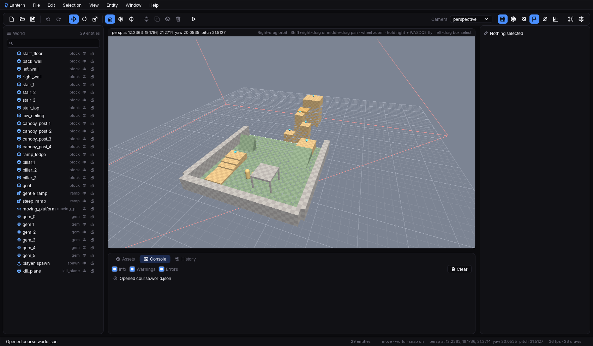

# Lantern world editor

The world editor opens a world file, shows it in a 3D viewport and lets you select, move, rotate,
scale, add, duplicate, mirror, align, group, hide, lock, re-parent and delete entities, edit their
fields, undo and redo, play the level in the real game and save. It is isolated from the game: it
never links the game, and the game never links it. The two share only the world file format
(`engine/src/world/`) and the game's assets.



## Architecture

```text
apps/world-editor                                     engine/ (Nox)
┌──────────────────────────────────────────┐          ┌──────────────────────────────────┐
│ src/ui/*.chaos *.cosmos *.nyx            │          │ lantern:::editorbackend          │
│   menus, toolbar, outliner, inspector,   │          │   EditorBackend                  │
│   assets, console, history, settings,    │          │   ├── EditorSession              │
│   palette, dialogs, status bar           │          │   ├── off-screen GpuRenderer     │
│   Editor services via @provide/@context  │          │   ├── preview, thumbnails, play  │
│        │ calls editor*() host functions  │          │                                  │
│ nox/src/EditorFunctions.nox ─────────────┼─────────►│ lantern:::editorapi              │
│ nox/src/ViewportRenderers.nox ───────────┼─────────►│   (src/EditorApi.nox)            │
│   a renderer per view: level, preview,   │          └──────────────────────────────────┘
│   thumbnail:<template>                   │
│ nox/src/main.nox: window, frame loop     │
│                                          │
│ Nox Penumbra · penumbra-bridge · Chaos · │
│ Cosmos · nyx-proto (lantern-native)      │
└──────────────────────────────────────────┘
```

- **`lantern:::world`** (`engine/src/world/`) is the seam. It defines the JSON world file (`WorldFile`,
  `WorldEntity`, shapes, materials, tints, colliders and free-form properties) and turns a world
  into meshes and collision triangles (`BuildPieces`). The game host and the editor both use it.
- **`lantern:::editor`** (`engine/src/editor/`) is all the editor's logic, in plain Nox with no window or GPU:
  the document and its labelled undo history, selection, the orbit camera with presets,
  bookmarks and orthographic views, picking and box selection, the move, rotate and scale gizmos
  with snapping, world or local space and primary or centre pivots, the inspector's fields, the
  outline, hiding and locking, the editing operations, preferences and the input state machine.
  It is tested by the programs in `engine/tests/editor`.
- **The editor backend** owns one `EditorSession` and an off-screen `GpuRenderer`. It
  draws the viewport, the template thumbnails and the turntable preview into memory, launches
  the game for play-in-editor, and exposes everything through a C API
  (`engine/editor-backend/include/lantern_editor.h`). It is written in Nox
  (`engine/src/editorbackend/` and `engine/editor-backend/`, `docs/decisions.md` D-051) and built
  as a static library linked against the system SDL3. The editor's Nox host imports its
  `lantern:::editorapi` namespace directly.
- **`apps/world-editor`** is the front end. `nox/` is its host, a Nox program on Nox Penumbra:
  `main.nox` opens an SDL3 window, mounts the UI through penumbra-bridge's `BridgeHost`, registers
  the viewport renderers and runs the frame loop, and `EditorFunctions.nox` registers one Nyx host
  function per backend call (`editorRevision()`, `editorSelect(entity, additive)` and so on). The
  panels in `src/ui` are Chaos components styled by Cosmos, one component per file.
  `EditorApplication.nyx` only sets up the application. `App.chaos` provides an `Editor` whose services hold the shared UI state as signals: `EditorDocument` polls
  `editorRevision()` each frame and refreshes what it mirrors when the revision changes, and
  `EditorCommands`, `EditorOverlays`, `EditorKeyboard`, `EditorSelection` and `EditorLayout` do the
  rest. Components read it with `@context` and keep their own state (`docs/decisions.md` D-031 to D-040,
  D-055).

### What the editor knows about the game

Nothing by name. The game ships `games/platformer/assets/editor/palette.json`, which lists:

- **templates** for the asset browser and the Entity menu (a label plus a partial entity: kind,
  shape, material, tint, collider, properties, and how far to lift it above the surface it
  lands on);
- **markers**: how to draw an entity that has no shape (a gem mesh, a capsule, a plane outline),
  by kind;
- **materials**: the names the inspector offers, each a texture in `games/platformer/assets/textures/`.

The palette also offers **Point light**, **Spot light** and **Sun**. They are entities like any other (their kinds
are `point_light`, `spot_light` and `sun`), their numbers are properties in the inspector, and the viewport lights the
scene with them as you edit. See `lighting-and-shadows.md`.

Every folder in `games/platformer/assets/silhouettes/` is added to the same list as a template (a Silhouette with the same name as a
palette entry replaces it). Placing one inserts its root and children together as one undo step, and **Edit** in the asset browser opens its components in a tab. See `silhouettes.md`.

Without a palette the editor still works, with generic blocks, ramps and markers.

## Build and run

From the lantern checkout's root, `mist install` fetches and builds everything the editor needs
(`engine/README.md`), and `mist run editor` builds the Nox host and opens
`games/platformer/assets/worlds/course.world.json`, or the world given after `editor`:

```sh
mist install
mist run editor path/to/other.world.json
```

`mist run editor --host-surface apps/world-editor/src/ui/editor-host-surface.json` writes the names the
editor's host registers (its `editor*` functions, penumbra-bridge's `penumbra:::` functions,
`appInstance`, `Application`'s members, `Component` and `@signal`) for `nyx check` and nyx-lsp,
through `src/ui/.nyx.json`. Rewrite it and commit it after changing a host function.

The backend is tested without the app. Its Nox parts are in the engine's test suite
(`engine/tests/editor/` and `engine/tests/editorbackend/`, run by `mist run test`),
and `engine/editor-backend` builds on its own with a C test of the whole C API. Its CMake asks
`mist resolve` where cgltf and stb_image are, so run `mist install` first:

```sh
cmake -S engine/editor-backend -B engine/editor-backend/build -G Ninja
cmake --build engine/editor-backend/build
ctest --test-dir engine/editor-backend/build --output-on-failure   # needs a GPU or lavapipe for the render test
```

`LANTERN_REQUIRE_GPU=1` turns a skipped render into a failure, and `LANTERN_EDITOR_CAPTURE=out.ppm`
saves the rendered viewport.

## Modes and the Silhouettes panel

The editor works in one of two modes, Select and Terrain. There are no mode buttons: selecting a terrain adds its brushes
to the tool palette, and picking one enters Terrain mode, which Done or Escape leaves. Shift+1 and Shift+2, the Window
menu and B switch too. Each mode shows only its own menus, panels and drawer pages, and a Silhouette or graph tab hides
the level's. The mode's tools are in the tool palette, which docks at the viewport's left or floats where its grip (shown
on hover) drags it. Everything is placed on the level from the Silhouettes panel, which pops out from the button on the
viewport's right-hand rail (or Shift+A): categories, a search box and a grid of thumbnails.
[editor-modes.md](editor-modes.md) lists what each mode shows.

## The panels

The outliner and the details panel are docked on the right, the viewport fills the middle and the content
drawer (assets, console, history) sits under it. Each can be shown or hidden from the Window menu or with
Alt + 1, 2 and 3, and the choice is remembered. F11 hides all of them for a clean viewport.

The viewport's own settings are in its header: `Perspective` opens the Camera menu (presets, orthographic, frame
and align) and `Show` opens the Show menu (grid, wireframe, colliders, markers, level bounds, hidden entities,
statistics, snapping, grid size). Alt+C and Alt+V open them from the keyboard, and pressing the same keys again closes the menu. An entity's tab (F4) shows a turning picture of that entity drawn with its current values above its component list.

Above the viewport is a row of document tabs. `Level` is the viewport. F4, Entity > Edit in Tab or the entity's right
click menu opens a tab for the selected entity, which lists its components (Entity, Transform, Shape and so on) and edits the chosen one's values in the page itself; the outliner and details
stay docked on the right and follow the tab, and double click still renames. Ctrl+W or the x closes a tab, Ctrl+Tab goes
to the next one, and deleting an entity closes its tab.


- **Menu bar**: File (new, open, recent files, save, save as, play, settings, quit), Edit
  (undo, redo, duplicate, duplicate along an axis, mirror, delete, snap, space, pivot),
  Selection (all, invert, children, similar, isolate, deselect, hide, unhide all, lock, unlock, unparent,
  group, align and distribute along an axis), View (larger and smaller grid, frame, camera presets, bookmarks,
  grid, wireframe, colliders, markers, level bounds, hidden entities, stats, orthographic,
  align camera and selection), Entity (one entry per template, snap to ground, revert to and
  apply to template), Window (each panel with a tick and its shortcut, hide all panels, settings) and Help
  (controls, keyboard shortcuts, about).
- **Toolbar**: Play (white, or green with Stop while the game runs) and Pause in
  the middle, and the command palette and settings. Everything else is in the menus, the tool
  palette and the viewport header (Snap, World or Local, Pivot). Every button has a tooltip.
- **Outliner**: the entity tree with a search box, kind icons, expand and collapse, eye and
  lock toggles per row, click and Shift-click selection, and drag-and-drop: drop on a row to
  parent under it, on the line between two rows to move just before the lower one (taking its
  parent), and on the empty tail to move to the end of the root. Double-click a row or press F2 to rename it: Enter
  keeps the new name and Escape cancels. Right-click opens a context menu.
- **Viewport**: the level, with the camera's description and the controls hint in its header.
  Drop a template from the asset browser into it to add an entity under the cursor.
- **Inspector**: the selection's fields in collapsible groups. Vectors edit X, Y and Z side by
  side, choices are dropdowns, flags are checkboxes, tints show a swatch. With several entities
  selected, a field shows "mixed" where they differ and an edit applies to all of them. The
  properties group adds, renames and removes free-form properties.
- **Assets**: a card per template with a rendered thumbnail; selecting one shows it spinning in
  the preview, "Add to world" adds it at the camera's focus, and dragging it into the viewport
  adds it where it lands.
- **Console**: the status line's history with info, warning and error filters.
- **History**: every undo step by label; click one to jump to it.
- **Settings** (Ctrl/Cmd + ,): Viewport (view options, grid spacing), Graphics (quality level, bloom, ambient
  occlusion, anti-aliasing, light shafts, shadow quality), Snapping (steps), Camera (presets, orthographic,
  bookmarks), Editor (recent files, preferences file).
- **Command palette** (Ctrl/Cmd + Shift + P): every command by name. Click the field, type,
  then Enter runs the first match.
- **Status bar**: the last message, entity and selection counts, tool, space, snap, camera, the editor's frame time
  (average and worst over the last 120 frames, the frames per second that average gives, and whether vertical sync is
  on) and what drawing the viewport cost (milliseconds and draw count).

The frame time is measured from the start of one frame of the window's loop to the start of the next, so it includes any
wait for the display. The editor redraws every frame (it never waits for a change), so with vertical sync on the frame
rate sits at the display's refresh rate or a fraction of it and the average says little about how much headroom there is.
For the real ceiling turn vertical sync off, either in Settings, Graphics, Frame rate, or by starting the editor with
`LANTERN_VSYNC=0`. The viewport figure is the time the GPU renderer took to draw the picture, which does not include the
UI or the wait for the display, so it shows how much of a frame the 3D view costs.

The Graphics tab changes how the editor viewport is drawn, with the same levels and effects as
`lantern:::graphics:::SetQuality` in a game (`docs/graphics-effects.md`). Choosing a quality level sets the five effect
checkboxes and the shadow quality together; a checkbox or the shadow quality can then be changed on its own. The
default is medium, which is what the viewport drew before the tab existed. The options are the view options `quality`,
`shadow_quality`, `bloom`, `ambient_occlusion`, `anti_aliasing`, `light_shafts` and `reflections`, so they are saved with the other
preferences.

Preferences (window size, snapping, view options, bookmarks, the open bottom panel and recent
files) are saved to `~/.config/lantern/world-editor.json` on quit and from the settings dialog.

## Controls

In the viewport:

| Input | Action |
|---|---|
| Left click | Select (Shift adds or removes) |
| Left click again on the same spot | Select the next entity behind, front to back, then wrap |
| Left click on a face of the view cube (top-right corner) | Snap to that face's camera preset |
| Left drag on empty space | Box select |
| Left drag on a gizmo handle | Move, rotate or scale along that axis or plane |
| Left drag on a selected object | Move it across the surface under the cursor |
| Right drag, or Alt + left drag | Orbit |
| Shift + right drag, or middle drag | Pan |
| Wheel | Zoom |
| Hold right button + W A S D Q E | Fly |
| W / E / R | Move / rotate / scale tool |
| X / Z | Toggle world or local space / primary or centre pivot |
| F / Home | Frame the selection / frame everything |
| End | Snap the selection to the ground |
| G | Toggle the grid |
| H / Shift + H | Hide the selection / unhide all |
| 1 to 9, Ctrl/Cmd + 1 to 9 | Go to a camera bookmark / set it |
| Delete or Backspace | Delete the selection |
| F2 | Rename the selected entity in the outliner |
| Ctrl/Cmd + Z, Ctrl/Cmd + Shift + Z or Ctrl + Y | Undo, redo |
| Ctrl/Cmd + D / G / A | Duplicate / group / select all |
| Esc | Cancel a drag, or clear the selection |

Anywhere in the editor:

| Input | Action |
|---|---|
| Ctrl/Cmd + N / O / S / Shift + S | New, open, save, save as |
| Ctrl/Cmd + P / Shift + P | Play or stop / command palette |
| Ctrl/Cmd + , | Settings |
| Ctrl/Cmd + L / Shift + L / I | Lock / unlock / invert the selection |
| Ctrl/Cmd + Q | Quit (asks about unsaved changes) |
| Shift + 1 / 2 | Select mode / Terrain mode |
| Shift + A | The Silhouettes panel at the pointer, or put it away (Select mode) |
| Alt + 1 / 2 / 3 | Show or hide the outliner / details / content drawer |
| Ctrl + Space, ` or Alt + 4 | Assets, console or history in the content drawer (again hides it) |
| F11 | Hide every panel for a clean viewport, or bring them back |
| Right click on an outliner row | Context menu |
| Esc | Close the open menu, popup or dialog |

Shortcuts not listed here go to the viewport whatever the pointer is over. Snapping steps
default to 0.25 m, 15° and 0.1 scale and are set in Settings.

In the inspector, typing applies as you go: each keystroke that parses is applied, and a run of
typing into one field is one undo step. Invalid text is reported in the console and doesn't
change the world.

## Play in editor

Play saves the level to `.editor-play.world.json` beside the game's worlds and runs the
`lantern` runner on it with `LANTERN_LEVEL` set, so what plays is what you see, saved or not.
`LANTERN_LEVEL` names the level inside the assets directory (`worlds/.editor-play.world.json`) and
`LANTERN_ASSETS` names that directory, so the game finds the level whether the editor was given a
relative or an absolute assets directory.
Stop ends the game. The game's own window opens; the editor stays usable.
Pause, beside Play while the game runs, holds the game still and turns orange; press it again to carry on. The editor
pauses by creating `.editor-play.paused` beside the scratch level, whose path it passes as `LANTERN_PAUSE_FILE`; the
game's loop looks for that file a few times a second and, while it is there, runs no simulation steps and gives the game
no elapsed time, but keeps drawing and reading events.

Play starts where you are looking, not at the start of the level. If something is selected the player starts at that
entity; otherwise at the editor camera (the point the camera is centred on in an orthographic view such as top or front),
facing the way the camera faces. The game skips the title screen, drops the point to the ground below it, puts the
companion beside the player (the route companion at her nearest stop, the partner at the nearest team beat) and makes
that spot the level's restart point. If there is no ground below the point, the game starts at the level's own spawn.
The editor adds the starting point as a `play_start` entity in the scratch copy only, so the open level is not changed.
Select a **Player start** or **Debug start** (Entity menu) before pressing Play and the game starts at it as authored,
with its own settings, instead of dropping the camera's point to the ground.
Close the game window or press Stop to come back: the editor's camera, selection and undo history are as you left them.

## C API rules

- One handle, used from one thread (the UI thread). A null handle is ignored.
- Strings passed in are NUL-terminated UTF-8, borrowed for the call. Strings returned stay valid
  until the next string-returning call on the same handle, so copy them straight away.
- Entity ids are the world file's ids as `int64_t`; 0 means none.
- No failure crosses the boundary: a call that fails is logged, shown in the console where it can be,
  and returns its default.
- `lantern_editor_revision` changes whenever anything a panel shows changes (camera moves don't
  count), so the front end polls it once a frame instead of receiving callbacks.
- Pixel buffers (`lantern_editor_pixels`, `lantern_editor_preview_pixels`,
  `lantern_editor_thumbnail`) are RGBA, valid until the next render of the same view.

## Known gaps

These are filed under the "Game engine" epic on the Nyx kanban in fearless-hq.

- **A click shorter than one frame is lost.** Penumbra samples mouse buttons once per frame
  rather than queueing press and release events.
- **No focus API from Nyx.** The command palette and the outliner search can't take keyboard
  focus by themselves, so click the field first.
- **Ctrl/Cmd + A doesn't select a text field's contents**, so you clear a field with Backspace.
- **Non-ASCII text in a `.chaos` element is a lex error** (NYX0001), so labels use ASCII.
- **Per-frame hover.** Penumbra fires `onHover` every frame the pointer is over an element, so
  tooltips and hover state are debounced in Nyx.

## Content browser

The Assets panel shows a folder list on the left and the open folder as cards. Silhouettes show their rendered thumbnail, can be dragged into the level and opened with Edit; scripts, graphs, textures, models, sounds, music and worlds show an icon and their kind, and a graph opens in the Graph tab. The search box finds anything by name across every folder.

## Terrain tab

Beside Silhouettes in the bottom panel (Alt+6, Window > Terrain or Terrain > Terrain Settings): the brush, generator and size settings. The Terrain menu and the brushes in the tool palette (B turns the brush on and off) run the commands. See [terrain.md](terrain.md).

## Silhouettes tab

Beside Assets in the bottom panel (Alt+5, or Window > Silhouettes), this tab lists every Silhouette. The search box filters them by name; drag a card into the level, or select it and press Add to world, or Edit to open its editor.

The Silhouette editor has three columns: the component tree with Add a child and Arrange on the left, a large preview with the selected component's values in the middle, and the actions on the right grouped as Component, Edit a value, Behaviour graph and This Silhouette.

## Game lighting

Show > Game Lighting (or Settings > Graphics) draws the viewport with the game's night look: its sky, fog, moon, ambient light, bloom and colour grade. Lights placed in the level light it as they will in the game. It shows the first chapter's night; other chapters, the day look and wet streets are not in the viewport yet.

## Material Silhouettes

A material is a Silhouette of type `material` (`@type material` in its `root.calamus`) with `texture`, `tint`, `metallic`, `roughness` and `emissive`. Put one in `games/platformer/assets/silhouettes/materials/NAME` (or `games/platformer/assets/silhouettes/NAME`) and give an entity that `material` name: the viewport draws it with the material's metallic, roughness, emissive and tint on top of its texture. A material name with no Silhouette still means the texture of that name. The content browser lists material Silhouettes with a material icon; the Silhouettes tab doesn't, since they aren't placed in a level. Starters: `brushed_steel`, `warm_plaster`, `wet_asphalt` and `neon_sign`. The game never reads Silhouette files: saving in the editor (or `mist run materials`) writes `games/platformer/game-assets/BakedMaterials.nyx`, a generated Nyx file whose `Register()` calls `lantern:::world:::SetMaterialLook` for each material, and the game imports it. A material Silhouette can also have a material graph, edited in the Graph tab under **Materials** with a live preview, which gives it a shader of its own: see `docs/material-graphs.md`.

## Player starts

A level can hold any number of `player_start` entities: **Player start** and **Debug start** in the palette. Where the
entity stands and which way it faces (rotate it about Y) is where the player begins. Its properties say the rest:

| Property | Meaning |
| --- | --- |
| `label` | The name to pick it by. |
| `order` | Of the ordinary starts, the lowest is the level's start. A level with none keeps its `spawn`. |
| `debug` | 1 keeps it out of ordinary play. A debug start is used only when asked for. |
| `spawns` | Who is made, comma separated: `player,partner,companion`. Leave one out to test without her. |
| `give_lantern` | 1 starts the player carrying the lantern. |
| `beat` | The team beat the partner begins at. Without it, the beat nearest the start. |

Ask for a start by label with `LANTERN_START=gate mist run game` (this also skips the title screen), or select it in the
editor and press Play.
